<div align="center">
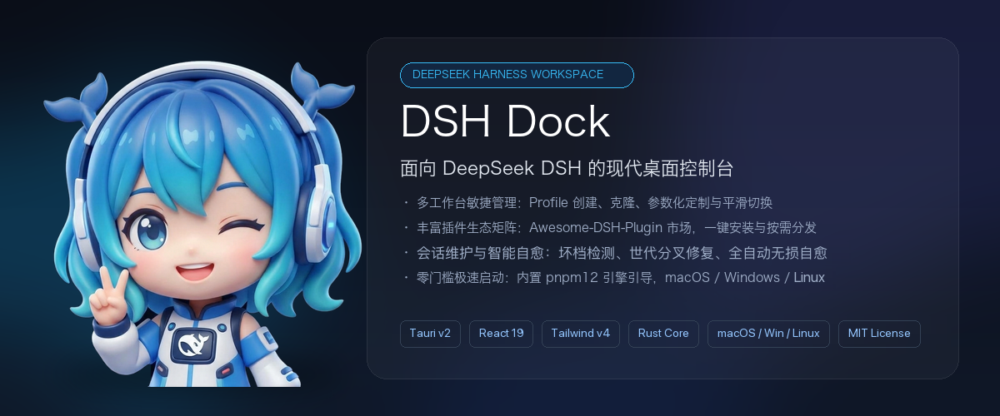

# DSH Dock

**专为 DeepSeek Harness (DSH) 打造的跨平台桌面控制中心**
<br />
*Desktop Control Center for DeepSeek Harness*

[](https://github.com/realguan/dsh-dock/releases)
[%20%7C%20Linux-3b82f6?style=flat-square)](https://github.com/realguan/dsh-dock/releases)
[](https://tauri.app)
[](https://react.dev)
[](https://www.npmjs.com/package/@deepseek-ai/dsh)
[](LICENSE)

<br />

> **"命令行留给极客，工作台交给 Dock。"**

<br />

[📥 下载安装](#-下载与安装) · [🎯 核心能力](#-核心能力) · [🖥️ 运行时与桌面集成](#️-运行时与桌面集成) · [⚡ 快速上手](#-快速上手) · [🏛️ 架构](#️-架构与设计原则) · [🗺️ 路线图](#️-路线图)

<br />

---

</div>

<br />

## 💡 什么是 DSH Dock？

[DSH](https://www.npmjs.com/package/@deepseek-ai/dsh)（DeepSeek Harness）是 DeepSeek 官方的智能体开发工具链，通过文件驱动架构与 Cordis 插件系统提供强大的 AI 编程和任务编排能力。

**DSH Dock** 是为 DSH 打造的**跨平台桌面客户端与独立控制中心**（基于 Tauri v2 + Rust + React 19），补齐官方 CLI 尚未提供的可视化管理体验：

- 🪶 **安装包 22 MB 起** — 各平台独立打包，内置 pnpm 引导器，不预装 Node.js 与 DSH
- 🛡️ **严守 Non-Fork 原则** — 不修改上游 DSH 任何源码，通过官方 CLI 规范与文件契约协同，与上游始终保持同步
- 🌐 **多语言界面** — 支持中文与 English，跟随系统语言自动切换
- ⚡ **开箱即用** — 无需预装 Node.js / pnpm / DSH，首次启动自动补齐
- 🖥️ **三平台覆盖** — macOS（Apple Silicon / Intel）、Windows（含 WSL2 穿透）、Linux（deb / rpm / AppImage）

<br />

---

## 🎯 核心能力

DSH Dock 的三个主模块与应用内导航一一对应，另有一层贯穿全局的壳层能力：

| 模块 | 应用内位置 | 解决什么 |
| :--- | :--- | :--- |
| **① 多工作台管理** | 控制中心 → `Profile 列表` | 工作台的创建、克隆、重命名、删除、启动与单工作台插件/实验能力/MCP/Patch 配置 |
| **② 插件中心** | 控制中心 → `插件中心` | 3,400+ 社区插件的跨工作台检索、安装与已装总览 |
| **③ 系统控制台** | 控制中心 → `系统控制台` | 偏好与守护、模型凭据、引擎配置、健康诊断与运行日志 |
| **壳层能力** | 贯穿全局 | 运行时自举、原生子视窗内嵌、托盘常驻、熔断守护、自动更新 |

<br />

### ① 控制中心 · 多工作台管理

官方 CLI 只提供 `--profile <name>` 启动与 `--from-default-profile <template>` 从模板派生（派生即启动），没有工作台的列举、重命名、克隆或删除命令。Dock 提供完整的可视化生命周期管理：

- **一览全局**：查看每个工作台的运行状态、默认启动标签与插件数量统计
- **安全克隆**：复制工作台时自动排除 `node_modules`，自动改写包名，保证物理隔离
- **运行防护**：运行中的工作台自动锁定，防止误删误改
- **默认工作台**：设定后下次启动直达常用工作流
- **官方保留工作台**：官方桌面端（Electron）独占的 `desktop` 工作台会标上「官方保留」——**启动、重启、设为默认、重命名、删除**这类生命周期操作关闭并说明原因（dsh 启动器拒绝第三方启动它）；**插件安装/卸载/更新/启停、实验能力、MCP 等内容管理照常可用**（内容面的 CLI 通道由壳的引擎 bootstrap 以 dsh 自己的载体开关与公开 API 走通，不经被守卫的命令行入口）。想整体另起一份配置，也可「复制」成一个别的名字再启动
- **默认启动哪个工作台**：未设置默认值时按产品清单声明的出厂工作台（`web`）启动；存在多个可启动工作台、且你从未设过默认值时会先出启动中心，选过一次即按「记住我的选择」直进；默认值随时可在控制中心改（星标「设为默认启动」）
- **官方转发**：新建工作台走 `dsh plugin` 官方 CLI 转发链，其余生命周期操作在文件层完成并严格遵循 dsh 的文件契约（不修改上游源码）

**启动中心（Launchpad）** 是进入应用后的第一站：多工作台时以卡片网格呈现全部工作台及其运行态、默认标签与插件数，点卡片或按数字键 `1-9` 直达，勾选「记住我的选择」则下次启动直接进入——不必再记 `--profile` 参数：

<div align="center">
  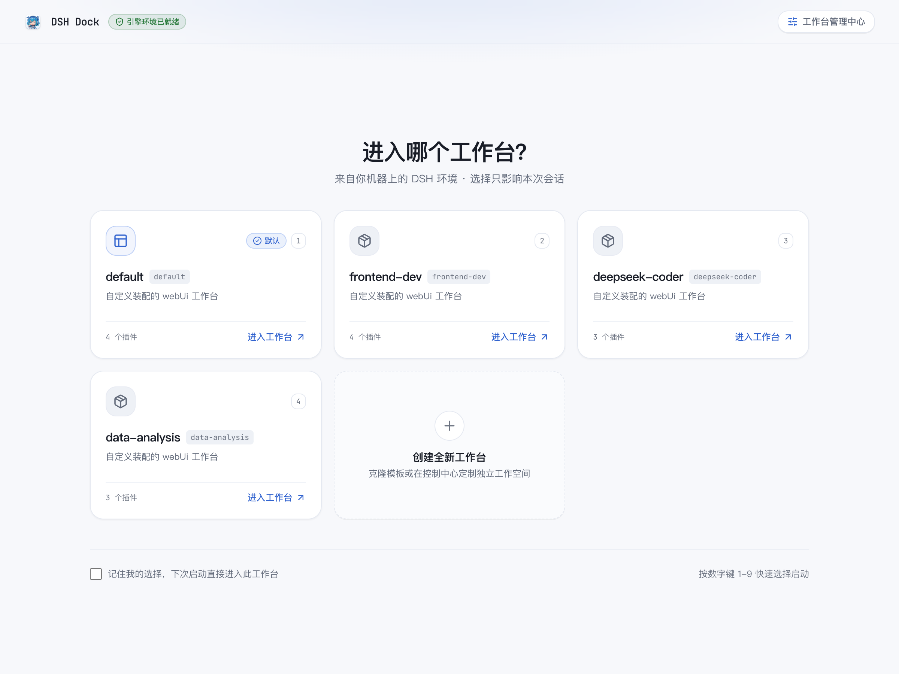
  <p><em>启动中心：多工作台卡片网格、数字键直达与「记住我的选择」</em></p>
</div>

<div align="center">
  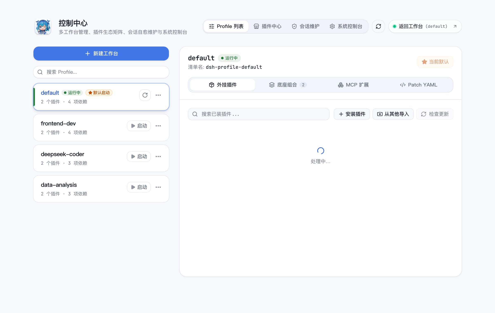
  <p><em>控制中心：左侧工作台列表（状态、默认标签、插件数），右侧详情面板</em></p>
</div>

<br />

#### 工作台生命周期管理

<table>
  <tr>
    <td width="50%" align="center">
      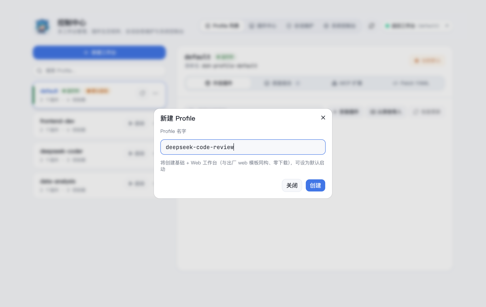
      <br />
      <strong>✨ 新建工作台</strong>
      <br />
      <sub>输入名称即可创建隔离工作台，自动初始化基础依赖</sub>
    </td>
    <td width="50%" align="center">
      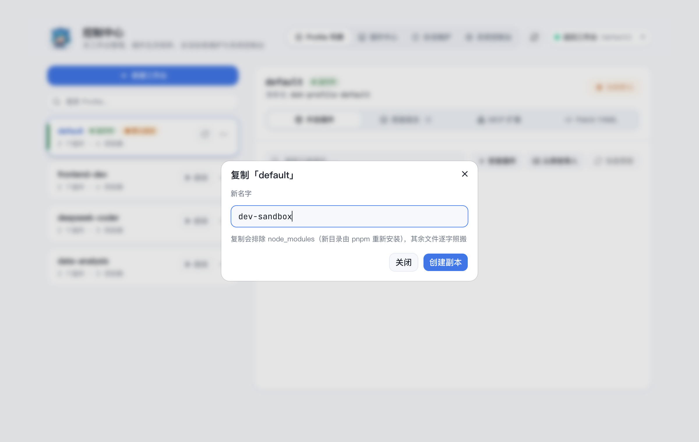
      <br />
      <strong>📋 安全克隆</strong>
      <br />
      <sub>排除 <code>node_modules</code>，一致化改写包名，物理隔离</sub>
    </td>
  </tr>
  <tr>
    <td colspan="2" align="center">
      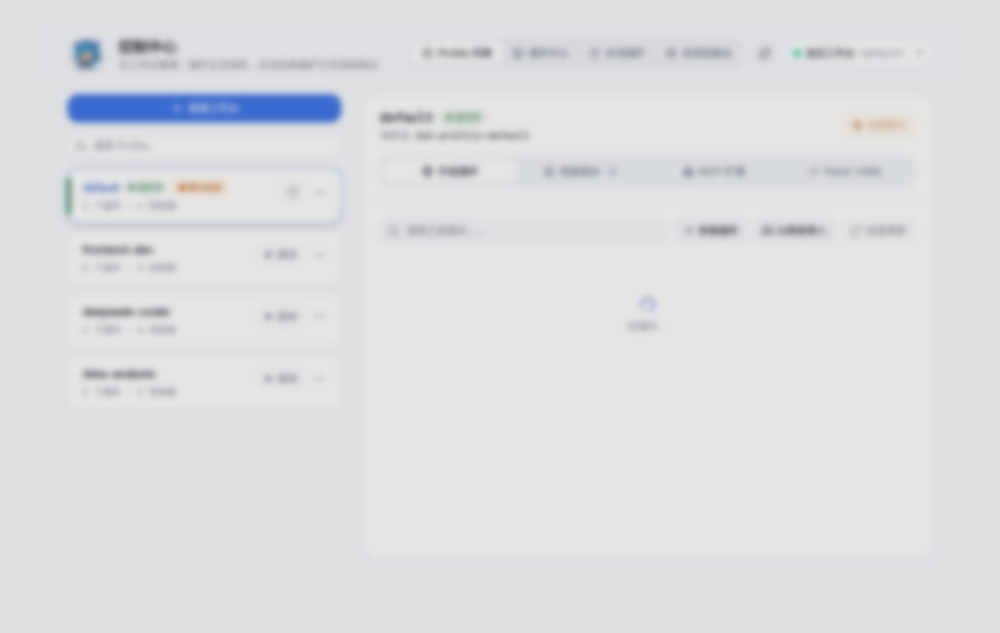
      <br />
      <strong>🛡️ 安全删除</strong>
      <br />
      <sub>运行中工作台自动锁定；删除时明确提示不影响全局历史会话</sub>
    </td>
  </tr>
</table>

<br />

#### 工作台详情面板

选中任一工作台后，右侧详情面板以 4 个 Tab 呈现其内部构成：

- **插件列表**：包含 **「已装插件」** 与 **「自研插件」** 两个子视图——「已装插件」支持按 **社区 / 内置 / 实验性** 三类筛选（默认展示社区插件），呈现已装版本、实时运行态徽标与行内启停开关，并提供统一的「添加插件」弹窗（支持市场选购、从其他工作台导入、自定义包名三合一）与「检查更新」入口；「自研插件」货架提供壳团队官方策展插件，首个上架 **DeepSeek 聊天内嵌**（`dsh-deepseek-chat-embed`），安装后可在应用窗口内以原生子视窗直接打开 `chat.deepseek.com`（右侧栏并排查阅或中央全屏对话），登录态随工作台持久保存
- **实验能力**：统一管理 DSH 官方以实验包形式发布的能力（浏览器操作、桌面控制、自动安全审查等），支持展开比较各后端并就地切换、停用或彻底移除
- **MCP**：结构化配置 Model Context Protocol 服务器，支持 **当前工作台 / 全局（`$DSH_HOME`）两层生效范围** 切换与就地 **能力探测**
- **Patch**：基于 CodeMirror 6 的 `cordis.patch.yml` 在线编辑器，支持行号、语法高亮、代码折叠、`⌘/Ctrl + F` 查找与覆写前自动备份

**插件列表**是一屏看清"这个工作台装了什么、跑没跑起来"的地方——每行展示插件名、已装版本、配置态与运行态徽标（运行中 / 加载中 / 失败 / 已禁用），并提供行内启停开关（自动轮询观测热载落定或提示重启生效）、更新与卸载；点「检查更新」后有新版的行会浮出可点的新版本号，可查看全部可用版本后选择性升级：

<div align="center">
  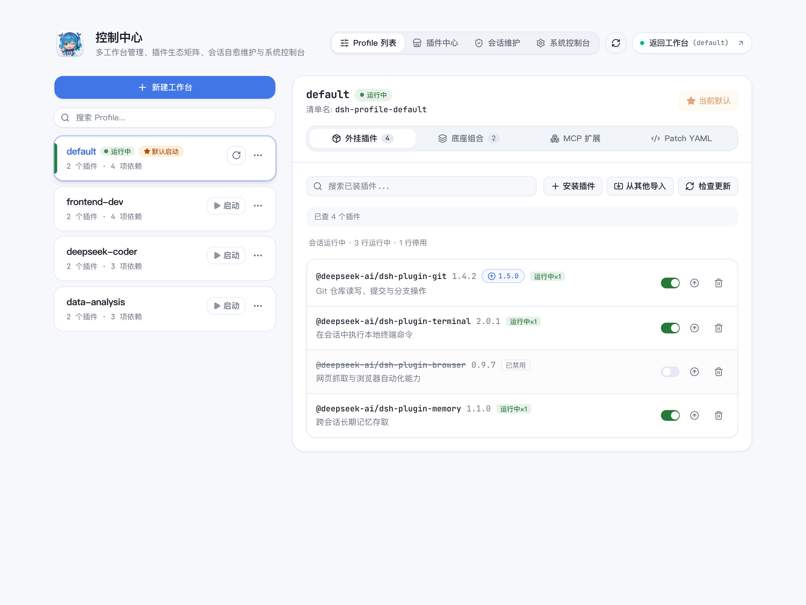
  <p><em>插件列表：版本、运行态徽标（运行中 / 已禁用）、更新提示与行内开关</em></p>
</div>

其中的 **MCP 服务器管理器**支持结构化配置（command / args / env 环境变量，兼容 `stdio` 与 `streamable-http` 传输）、当前工作台与全局两层范围切换、单个启用或禁用、一键探测服务器提供的工具与资源，并内置 4 个常用预设（GitHub Tools、Filesystem Sandbox、PostgreSQL Database、Brave Web Search）一键套用：

<div align="center">
  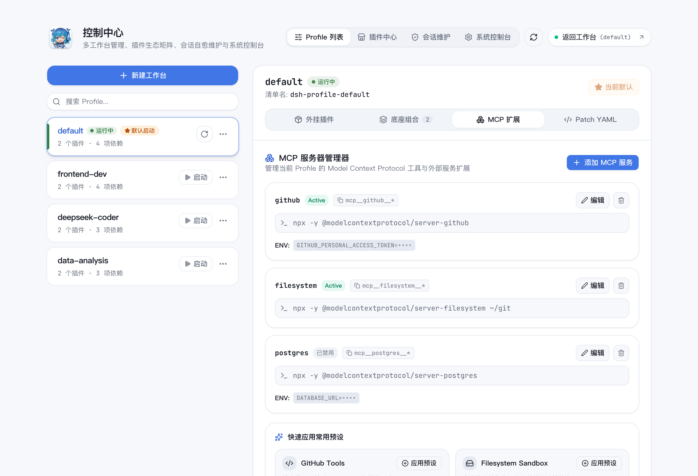
  <p><em>MCP 服务器管理器：结构化配置外部能力，常用预设一键应用</em></p>
</div>

<br />

### ② 插件中心 · 3,400+ 社区市场

官方 CLI 的 `dsh plugin add <package>` 要求你已知确切包名，没有发现与浏览入口。Dock 直通 Awesome-DSH-Plugin 社区 Registry：

- **分类检索**：覆盖 UI 增强、AGI 架构探索、模型与账号接入、主题外观等 20+ 分类，支持关键词搜索与下载量 / 星标排序
- **三种安装源**：npm 包名（支持指定版本/tag）、GitHub 仓库（支持子目录/分支）、HTTPS tarball 直链
- **一键安装到指定工作台**：卡片内直接选择目标工作台并发起安装
- **后台安装队列**：异步安装不阻塞界面，实时显示排队中 / 安装中 / 已安装 / 失败状态

<div align="center">
  
  <p><em>插件中心：社区插件市场浏览、分类筛选与一键安装</em></p>
</div>

<br />

### ③ 系统控制台 · 凭据与诊断

面向日常运维的系统控制台，包含 5 个子面板：

- **偏好与守护**：界面语言切换（跟随系统 / 中文 / English）、Windows 默认运行环境选择（每次询问 / 本地模式 / WSL 模式）、崩溃自动拉起开关、悬浮控制胶囊显隐、应用内快捷键方案选择（`⌘/Ctrl + ,` 或命令面板风格 `⌘/Ctrl + ⇧ + P`），以及插件安装源偏好（自动换源并记忆上次可用源 / 固定官方源 / 跟随本机配置）
- **模型凭据**：可视化录入和编辑 DeepSeek、OpenAI、Anthropic、Google Gemini、Moonshot (Kimi)、智谱 GLM、Groq、OpenRouter 等服务的 API Key，界面只显示脱敏掩码，支持一键清除；Raw 模式可直接编辑 `.credentials.yaml`，保存时原子写入，并在 **Unix 上强制 0600 文件权限**（Windows 无等价文件模式，依赖用户 profile 的默认 ACL）
- **DSH 引擎配置**：直接查看与编辑 `settings.yaml`，保存前弹出破坏性变更确认并自动备份
- **健康大盘**：一屏体检 Node / pnpm / DSH 三个运行时的版本、路径与就绪状态，展示 `DSH_HOME` 存储空间分布（Profile / 会话 / 缓存），支持一键复制诊断报告
- **运行日志**：2 类日志源（DSH Dock 壳日志 / DSH 运行时日志），支持关键词过滤、自动滚底与尾部 600 行实时追踪

<div align="center">
  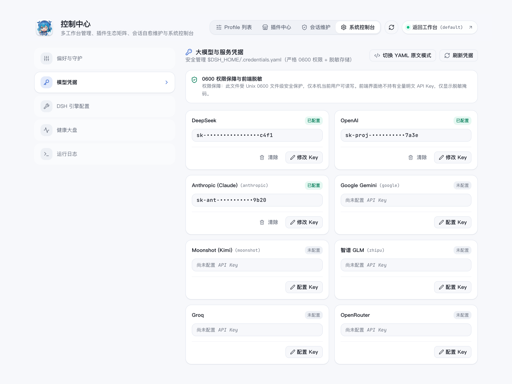
  <p><em>模型凭据：各服务商配置状态一目了然，界面永不持有明文 Key</em></p>
</div>

<div align="center">
  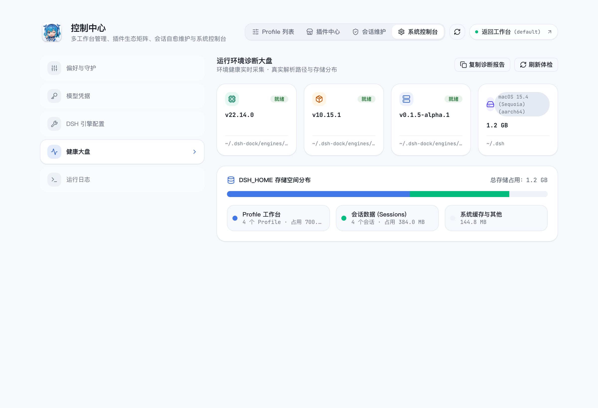
  <p><em>健康大盘：运行时版本与就绪状态、DSH_HOME 存储分布一屏掌握</em></p>
</div>

<div align="center">
  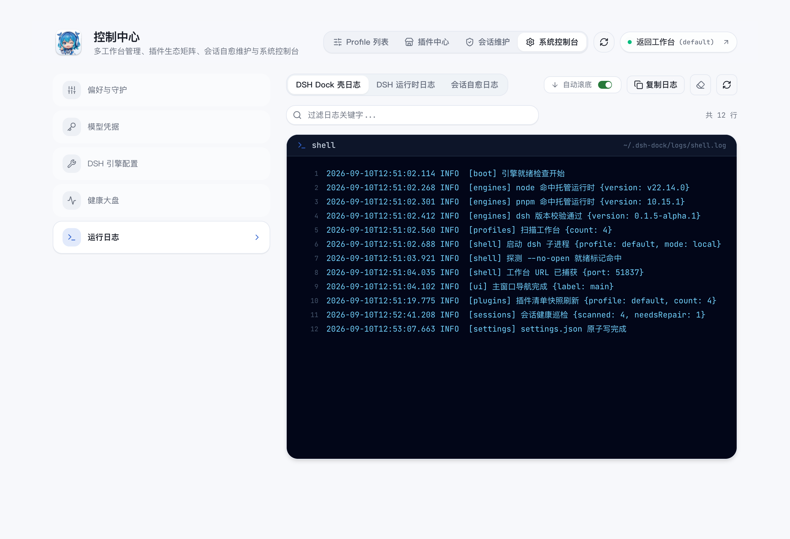
  <p><em>运行日志：壳日志与 DSH 运行时日志切换、关键词过滤与实时追踪</em></p>
</div>

<br />

---

## 🖥️ 运行时与桌面集成

贯穿各模块的壳层能力，让 DSH 在桌面上真正"开箱即用"：

- **零配置自举**：启动时检测 Node / pnpm / DSH 三者版本，缺失或版本不符即自动补齐，无需用户干预
- **dsh 运行时由壳自管**：引擎来自 Dock 自己的引擎目录（首次使用自动补齐），**不做 PATH 探测**——即使你已用 npm 把 `dsh` 装在 `~/.local/bin` 之类的用户目录，Dock 也不会接管那一份（既定口径：引擎归壳、环境探测层退役，见 ADR-0010）
- **来源可信**：Node 版本经独立签名映射包（ed25519 验签）锚定并提供 SHA-256 校验和，验签或校验失败一律回退内置基线，不放行未验签数据
- **镜像链加速**：内置镜像链优选高速源，网络异常自动切换备选
- **Windows 双模运行（零软链本地模式 + WSL2 穿透）**：本地模式通过模块目录代理实现全程零符号链接（普通账户开箱即用，无需管理员权限或开发者模式）；WSL2 模式自动探测发行版、打通 localhost 回环，并将工作台、插件、实验能力、MCP 探测与诊断全面下沉至 Linux 客体内部执行
- **本机优先**：凭据仅存本机 `~/.dsh`（Unix 下为 0600 权限；Windows 依赖 profile 默认 ACL），工作台与会话数据从不上传；网络面只用于引擎补齐、更新检查与插件市场拉取三件事
- **系统托盘常驻**：最小化运行，快速唤醒与重启。**关闭主窗口只是隐藏**（工作台进程继续跑），
  唤回方式：托盘左键 / 托盘右键「显示工作台」（Windows · Linux）、菜单栏「显示工作台」或点 Dock 图标（macOS）；若主窗口已被系统回收，点击「返回工作台」会自动重建窗口并恢复；
  真正退出请用托盘 / 菜单栏的「退出」
- **单实例防冲突**：多处点击自动聚焦已有窗口，不会产生重复进程
- **子进程全生命周期守护**：对所有拉起的子进程建立 PID 锁登记与守护，无论正常退出、崩溃还是被强制结束（`SIGKILL`）都会回收子进程，并在下次启动时清扫残留孤儿，不留僵尸进程
- **崩溃熔断守护**：60 秒内连续 3 次崩溃即停止自动重启，并显示带日志片段的启动失败卡片，避免死循环重启
- **WebView 内存保护**：长会话中自动应用 `content-visibility` 策略，抑制 WebKit 内存膨胀
- **悬浮控制胶囊**：工作台页面内的 Shadow DOM 悬浮按钮，应用内快捷键一键呼出控制中心
- **双轨自更新**：桌面客户端与 DSH 核心引擎分别独立检测、下载与升级；升级 DSH 引擎后若有活跃会话会自动重启接管新引擎
- **DSH 版本管理器**：从 Registry 拉取全版本列表，标注 稳定 / 候选 / 预览（Stable / RC / Alpha）通道，可自选任意版本安装或回退
- **关于与更新中心**：独立窗口展示客户端版本、DSH 核心、Node 运行时、工作台连接状态，支持一键复制诊断信息（缺少系统托盘的 Linux 桌面会在控制中心顶部自动补充入口）
- **品牌形象**：3D 鲸鱼娘 Whale-chan 吉祥物 + Apple HIG 标准桌面图标

<div align="center">
  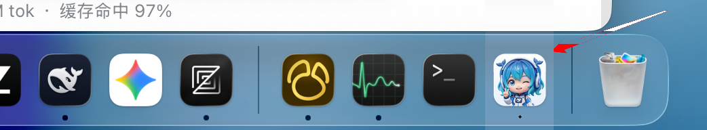
  <p><em>原生桌面融入：Apple HIG 规范圆角与透明边距，在 macOS Dock 中与系统应用同调</em></p>
</div>

<br />

---

## 📥 下载与安装

👉 **[前往 GitHub Releases 下载最新安装包](https://github.com/realguan/dsh-dock/releases)**

| 操作系统 | 支持架构 | 安装包格式 | 体积（约） | 说明 |
| :--- | :--- | :--- | ---: | :--- |
| **macOS** | Apple Silicon (arm64) | `.dmg` | 22 MB | 原生 ARM64，开箱即用 |
| **macOS** | Intel (x86_64) | `.dmg` | 24 MB | 原生 x86_64，非 Rosetta 转译 |
| **Windows** | x64 | `.exe` (NSIS) / `.msi` | 39 / 40 MB | 支持 Win 10 / 11，内置 WSL2 穿透；ARM64 设备经系统仿真运行 |
| **Linux** | x64 (amd64) | `.deb` / `.rpm` | 23 MB | Ubuntu / Debian / Fedora 等主流发行版 |
| **Linux** | x64 (amd64) | `.AppImage` | 94 MB | 免安装单文件；因内置 WebKit 运行时故体积偏大 |

> [!IMPORTANT]
> **首次启动需要联网**：安装包不内置 Node.js 与 DSH 引擎（这也是体积能保持在几十 MB 的原因）。首次运行时客户端会经镜像链拉取 Node 运行时并安装 DSH 引擎，补齐后即可离线启动，后续升级全部显式触发。

**其他架构**：当前发布产物覆盖 macOS（Apple Silicon + Intel）、Windows x64 与 Linux x64；Windows ARM64 等其余架构可参照 [CONTRIBUTING.md](docs/CONTRIBUTING.md) 从源码自行构建。

> [!TIP]
> **Intel Mac 选哪个包**：文件名带 `x64` 的 `.dmg` 是 Intel 原生版，带 `aarch64` 的是 Apple Silicon 版。两者是**独立构建**（非 universal 通用包），各自只内置对应架构的 pnpm 引擎，因此体积与原生性能都不打折；客户端自更新会按 CPU 架构自动取对应版本。

> [!WARNING]
> **macOS 首次打开**：若被系统安全策略拦截，在「系统设置 → 隐私与安全性」中点击「仍要打开」即可。

> [!NOTE]
> **Linux 托盘依赖**：托盘图标（及其上的「关于 / 检查更新」入口）需要 `libayatana-appindicator3`。
> 我们的 `.deb` / `.rpm` 已把它声明为 **Recommends**，`apt` / `dnf` 默认会装上；若系统确实没有它
> （例如 AppImage + 精简桌面），应用**仍能正常启动**，只是没有托盘图标 —— 此时日志会给出原因与安装命令
> （Debian/Ubuntu：`libayatana-appindicator3-1`，Fedora：`libayatana-appindicator-gtk3`）。

> [!NOTE]
> **Windows 首次打开**：安装包目前**未做代码签名**（macOS 已签名并公证，Windows 侧待证书），因此 SmartScreen
> 可能提示「未知发布者」；点「更多信息 → 仍要运行」即可。自动更新不受影响 —— 更新包用的是本项目自己的签名校验。

<br />

---

## ⚡ 快速上手

**Step 1**：下载并打开 DSH Dock。首次运行时，引导引擎会自动补齐 Node.js / pnpm / DSH 运行时。

**Step 2**：在启动中心选择或新建工作台。点击「+ 新建工作台」输入名称即可创建独立配置档案。

**Step 3**：进入工作台后即可与 DSH 智能体协作。随时通过悬浮胶囊或应用内快捷键（`Cmd/Ctrl + ,`）呼出控制中心，切换工作台或前往插件市场。

<br />

---

## 🏛️ 架构与设计原则

```
┌────────────────────────────────────────────────────────┐
│                   DSH Dock 桌面壳                      │
│                                                        │
│   ┌────────────────────────────────────────────────┐   │
│   │           前端 UI 层 (React 19 SPA)            │   │
│   │     控制中心    │    插件中心    │  系统控制台 │   │
│   └───────────────────────┬────────────────────────┘   │
│                           │ IPC (强类型安全通道)       │
│   ┌───────────────────────▼────────────────────────┐   │
│   │           内核层 (Rust + Tauri v2)             │   │
│   │   Resolve 宿主解析 │ Updates 验签/镜像链       │   │
│   │   Profiles 管理器  │ Executor (Local / WSL2)   │   │
│   │   Plugins / MCP    │ Lifecycle 进程/单实例守护 │   │
│   └───────────────────────┬────────────────────────┘   │
└───────────────────────────┼────────────────────────────┘
                            │ 严格遵守 Non-Fork 接口契约
┌───────────────────────────▼────────────────────────────┐
│          DSH 官方运行时 (@deepseek-ai/dsh)             │
│   ~/.dsh/ (profiles, cordis.patch.yml, sessions)       │
└────────────────────────────────────────────────────────┘
```

- **Non-Fork 原则**：不修改上游 DSH 源码，所有协同通过官方 CLI 规范、文件系统与环境变量完成
- **壳产品分离**：壳本体不感知产品硬编码，运行时遵从 `product.manifest.json` 契约
- **技术栈**：Rust 2021 + Tauri v2 / React 19 + TypeScript Strict + Tailwind CSS v4 + Zustand + Radix UI + CodeMirror 6

<br />

---

## 🗺️ 路线图

- [x] **v0.1 ~ v0.3**：Tauri v2 壳体 · 运行时自举链 · WSL2 穿透 · 签名验证
- [x] **v0.4**：Profile 可视化管理 · 插件市场 · 自动更新 · Whale-chan 品牌
- [x] **v0.5 ~ v0.9**：凭据管理 · MCP 配置器 · 系统诊断大盘 · 实时日志 · DSH 版本切换 · 崩溃熔断 · 多语言
- [x] **v1.0**：启动台 Launchpad · 插件安装队列 · DSH 版本选择器 · 覆写前备份与操作确认
- [x] **v1.1 ~ v1.2**：重启/切换阶段导轨 · 子进程全生命周期守护 · macOS Intel 原生包 · Windows 零软链本地模式 · WSL 客体管理面下沉
- [x] **v1.3**：实验能力开关台 · 插件列表三类合一 · MCP 双层范围与能力探测 · CodeMirror 6 Patch 编辑器 · 官方保留工作台保护
- [x] **v1.4**：自研插件货架 · DeepSeek 聊天窗口内原生子视窗内嵌（`dsh-deepseek-chat-embed`）· 主窗口回收自动重建恢复
- [ ] **v1.5+（Next）**：
  - [ ] 会话时光机 — 时间轴回放与分支流转
  - [ ] 应用内命令面板（Command Palette）— 热键呼出、状态速览与即时问答
  - [ ] 工作台云同步 — 加密导出与跨设备 Profile 配置备份

<br />

---

## 🛠️ 参与开发

欢迎参与 DSH Dock 的开源共建！详见 [CONTRIBUTING.md](docs/CONTRIBUTING.md) 了解开发环境搭建、代码规范与 PR 准则。

```bash
git clone https://github.com/realguan/dsh-dock.git
cd dsh-dock/frontend && pnpm install && cd ../src-tauri && cargo tdev
```

<br />

---

## 🤝 社区与支持

- **反馈 Bug 或建议**：[GitHub Issues](https://github.com/realguan/dsh-dock/issues)
- **贡献代码**：[CONTRIBUTING.md](docs/CONTRIBUTING.md)
- **更新日志**：[RELEASE_NOTES.md](docs/RELEASE_NOTES.md) — 各版本功能演进与缺陷修复记录

<br />

## 📄 开源许可证

[MIT License](LICENSE)

<br />

<div align="center">
  <sub>Built with ❤️ by realguan and the community. Powered by DeepSeek Ecosystem.</sub>
</div>
